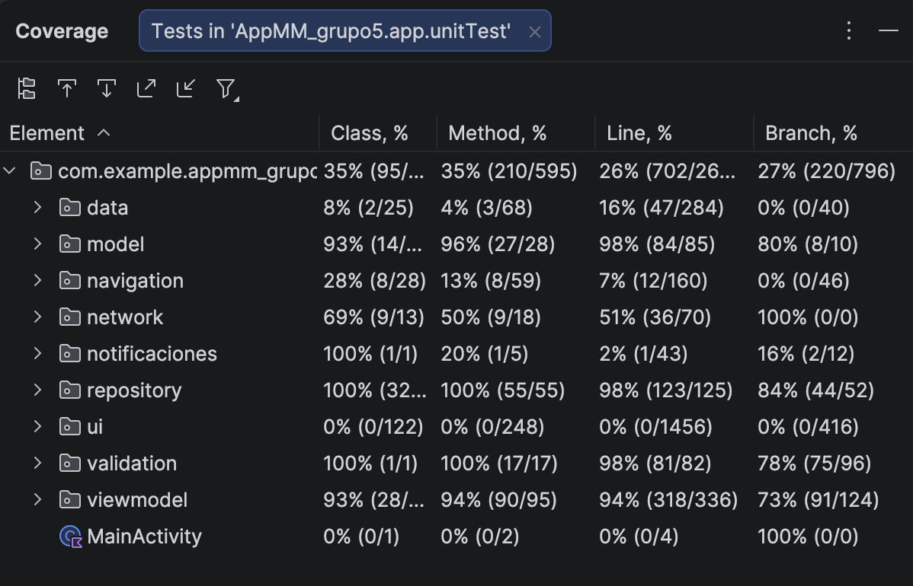
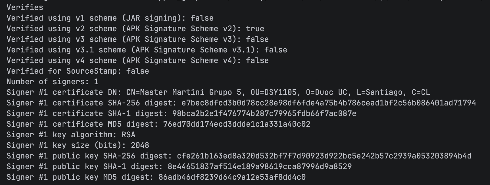
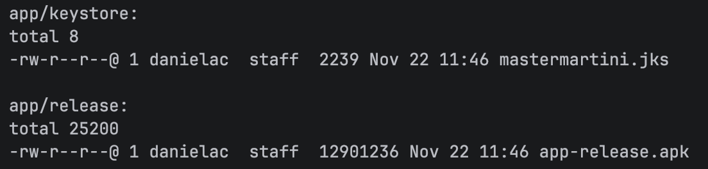

# App Master Martini - Grupo 5

**Integrantes:** Diego Reyes y Daniela Cuevas
**Asignatura:** Desarrollo de Aplicaciones Móviles (DSY1105) · Ingeniería en Informática · Duoc UC

Aplicación móvil en **Kotlin** y **Jetpack Compose** para el caso de **Master Martini Chile SPA**: una plataforma de contenidos técnicos (recetas, videos y cursos) para emprendedores y profesionales de pastelería, chocolatería, panadería y heladería.

Es un **MVP académico**: todos los datos y contenidos son ficticios.

---

## Arquitectura

La entrega está formada por tres partes que se comunican con **Retrofit**:

```text
┌──────────────┐   HTTP :8081   ┌──────────────────┐
│              │ ─────────────► │  ms-usuarios      │──► H2 (data/usuarios)
│  App Android │                └──────────────────┘
│  (Compose,   │   HTTP :8082   ┌──────────────────┐
│   MVVM)      │ ─────────────► │  ms-catalogo      │──► H2 (data/catalogo)
│              │                └──────────────────┘
│              │   HTTPS        ┌──────────────────┐
│              │ ─────────────► │ TheMealDB (API    │
└──────┬───────┘                │ externa, terceros)│
       │                        └──────────────────┘
       └──► Room (perfil del negocio y encuesta, en el teléfono) y DataStore (sesión)
```

- **ms-usuarios** y **ms-catalogo** son microservicios propios en Spring Boot con base de datos H2 en modo archivo (los datos se conservan al reiniciar).
- **TheMealDB** es una API externa de terceros, solo de lectura, que usamos en la pantalla "Ideas de postres".
- El perfil del negocio y la encuesta se guardan en el teléfono con **Room**, y la sesión con **DataStore**.

---

## Funcionalidades

1. **Sesión de usuario (ms-usuarios):** registro e ingreso con validación por campo en tiempo real. La clave se guarda como hash SHA-256 en el servidor y la sesión persiste con DataStore. Si el servidor responde que el usuario ya no existe, la sesión se cierra.
2. **CRUD de la cuenta desde la app:** crear (registro), ver (sesión), **editar** (nombre, celular y clave opcional) y **eliminar** la cuenta, desde la pantalla Perfil.
3. **Perfil del negocio:** nombre, RUT de la empresa (con dígito verificador), tipo de negocio, cantidad de personas y dirección. Foto de perfil desde la cámara o la galería.
4. **Encuesta de intereses:** intereses, objetivo y preferencia de recibir novedades.
5. **Catálogo (ms-catalogo), pantalla Aprender:** recetas, cursos y videos con filtros por tipo y por categoría, y un filtro "Guardados".
6. **Detalle de contenido y favoritos (ms-catalogo):** con opción de guardar o quitar de favoritos; los favoritos se guardan por usuario en el servidor.
7. **Ideas de postres (API externa TheMealDB):** lista de postres con imagen, buscador y detalle con categoría, origen e instrucciones.
8. **Notificaciones locales:** al guardar la encuesta con "Recibir novedades" activo, la app avisa de un contenido según los intereses elegidos.
9. **Manejo de errores de red:** mensajes claros cuando no hay conexión o el servidor no responde (con botón "Reintentar" donde corresponde).
10. **Diseño adaptable y animaciones:** tres disposiciones de la Home (teléfono, tablet mediana y expandida) con `WindowSizeClass`, barra de navegación inferior y animaciones en el splash, las transiciones y los formularios.

## Recursos nativos

- **Cámara** (permiso `CAMERA`, con `FileProvider`) y **galería** de fotos.
- **Notificaciones locales** (permiso `POST_NOTIFICATIONS` en Android 13 o superior).

---

## Microservicios (endpoints)

### ms-usuarios (puerto 8081)

| Método | Ruta | Descripción | Respuestas |
|---|---|---|---|
| POST | `/api/usuarios` | Registrar usuario. Body: `nombre`, `correo`, `telefono`, `clave` | 201, 400 (datos inválidos), 409 (correo repetido) |
| POST | `/api/usuarios/login` | Iniciar sesión. Body: `correo`, `clave` | 200, 401 (credenciales incorrectas) |
| GET | `/api/usuarios/{id}` | Obtener un usuario | 200, 404 |
| PUT | `/api/usuarios/{id}` | Editar. Body: `nombre`, `telefono`, `clave` (opcional) | 200, 400, 404 |
| DELETE | `/api/usuarios/{id}` | Eliminar la cuenta | 204, 404 |

Las respuestas nunca incluyen la clave. Base de datos: `jdbc:h2:file:./data/usuarios`.

### ms-catalogo (puerto 8082)

| Método | Ruta | Descripción | Respuestas |
|---|---|---|---|
| GET | `/api/contenidos?tipo=&categoria=` | Listar contenidos (filtros opcionales) | 200 |
| GET | `/api/contenidos/{id}` | Obtener un contenido | 200, 404 |
| POST | `/api/contenidos` | Crear contenido | 201, 400 |
| PUT | `/api/contenidos/{id}` | Editar contenido | 200, 400, 404 |
| DELETE | `/api/contenidos/{id}` | Eliminar contenido | 204, 404 |
| GET | `/api/favoritos/usuario/{usuarioId}` | Contenidos favoritos de un usuario | 200 |
| POST | `/api/favoritos` | Agregar favorito. Body: `usuarioId`, `contenidoId` | 201, 404 |
| DELETE | `/api/favoritos?usuarioId=&contenidoId=` | Quitar favorito | 204, 404 |

Al iniciar por primera vez carga 14 contenidos de ejemplo. Base de datos: `jdbc:h2:file:./data/catalogo`.

Ambos servicios tienen consola H2 en `http://localhost:{puerto}/h2-console` (usuario `sa`, sin contraseña).

## API externa: TheMealDB

Servicio público de recetas (`https://www.themealdb.com/api/json/v1/1/`), consumido con Retrofit en `MealApiService`:

| Método | Ruta | Uso |
|---|---|---|
| GET | `filter.php?c=Dessert` | Lista de postres (id, nombre, imagen) |
| GET | `lookup.php?i={id}` | Detalle de un postre (categoría, origen, instrucciones) |

**Diferencia con un microservicio propio:** TheMealDB es de terceros, solo lectura, no controlamos su contrato (por eso los campos son nulables y `meals` puede venir `null`) y no tiene base de datos nuestra. Los microservicios son nuestros: tienen CRUD, base de datos propia y un contrato que definimos nosotras.

---

## Tecnologías

- Kotlin 2.0.21 y Jetpack Compose con Material 3 (BOM 2024.09.00)
- Arquitectura MVVM con repositorios
- Retrofit 2.11 + Gson, OkHttp (logging) y Coil para imágenes
- Navigation Compose 2.8.5, con transiciones animadas
- Room 2.6.1 (con KSP) y DataStore Preferences 1.1.1
- Corrutinas y StateFlow
- Microservicios: Spring Boot 4.1 (Java 17), Spring Data JPA, Validation y H2
- Pruebas: JUnit 4, MockK y kotlinx-coroutines-test

## Flujo de datos

Pantalla → ViewModel → Repositorio → Retrofit → microservicio → H2 (usuarios y catálogo), o bien Pantalla → ViewModel → Repositorio → DAO → Room (perfil y encuesta). Las pantallas no contienen reglas: piden al ViewModel que valide y reaccionan al estado. Cada repositorio traduce los códigos HTTP (201, 401, 404, 409, etc.) y los errores de red a un resultado que la pantalla sabe mostrar.

## Estructura del código

```text
app/src/main/java/com/example/appmm_grupo5/
├── data/           # Room (DAOs de perfil y encuesta, AppDatabase), SesionDataStore
├── model/          # Entidades y estados de interfaz
├── navigation/     # NavGraph, Screen, NavigationEvent
├── network/        # Retrofit: RetrofitClient, UsuarioApi, CatalogoApi, MealApiService y DTOs
├── notificaciones/ # Canal y envío de notificaciones
├── repository/     # Repositorios (usuarios, catálogo, perfil, API externa)
├── ui/             # Componentes, pantallas y tema
├── validation/     # Reglas de validación (correo, celular, RUT, clave, etc.)
└── viewmodel/      # ViewModels
ms-usuarios/        # Microservicio de usuarios (Spring Boot)
ms-catalogo/        # Microservicio de catálogo y favoritos (Spring Boot)
```

---

## Cómo ejecutar

**Requisitos:** Android Studio reciente (compatible con AGP 8.13), JDK 17 o superior, `compileSdk` 36, `minSdk` 24 y `targetSdk` 36. Las notificaciones se prueban mejor en Android 13 o superior.

### 1. Encender los microservicios

En dos terminales distintas, desde la raíz del proyecto:

```bash
cd ms-usuarios
./mvnw spring-boot:run        # en Windows: .\mvnw.cmd spring-boot:run
```

```bash
cd ms-catalogo
./mvnw spring-boot:run
```

Quedan en `http://localhost:8081` (usuarios) y `http://localhost:8082` (catálogo). Las bases de datos se crean solas en la carpeta `data/` de cada servicio.

### 2. Ejecutar la app

1. Abre la carpeta raíz del proyecto con **Open** en Android Studio.
2. Espera la sincronización de Gradle (**Sync Project with Gradle Files**).
3. Elige un emulador y pulsa **Run** (▶) con la configuración `app`.

La app llama a los servicios en `10.0.2.2`, que desde el emulador es el computador anfitrión. La pantalla "Ideas de postres" necesita internet en el emulador.

No hay usuarios precargados: en la pantalla de Login usa **Regístrate** para crear una cuenta.

**Recorrido sugerido:** crear cuenta → completar el perfil y la encuesta → explorar el catálogo y usar los filtros → abrir un contenido y guardarlo como favorito → ver "Guardados" → abrir "Postres" y ver el detalle de uno → editar los datos de la cuenta → cerrar sesión → eliminar la cuenta.

## Pruebas

```bash
./gradlew :app:testDebugUnitTest          # pruebas unitarias
./gradlew :app:connectedDebugAndroidTest  # prueba de la base de datos (con emulador encendido)
```

Más de 100 pruebas unitarias en repositorios y ViewModels con **JUnit + MockK**, con la red, DataStore y Room mockeados (no necesitan emulador ni servidores).

**Cobertura de la lógica** (medida en Android Studio con *Run with Coverage*, en líneas): `repository` 98 %, `validation` 98 %, `model` 98 % y `viewmodel` 94 %. Las pantallas Compose no entran en esta medición.



---

## APK firmado

El APK de entrega está en `app/release/app-release.apk` y la llave con la que se firmó en `app/keystore/mastermartini.jks`. La llave se creó solo para este curso y no se usa en ningún otro proyecto.

| Dato de la llave | Valor |
|---|---|
| Archivo | `app/keystore/mastermartini.jks` |
| Alias | `mastermartini` |
| Contraseña del almacén y de la clave | `MasterMartini2026` |
| Algoritmo | RSA 2048, válida por 10.000 días |

**Cómo se creó la llave** (una sola vez):

```bash
keytool -genkeypair -v -keystore app/keystore/mastermartini.jks -alias mastermartini -keyalg RSA -keysize 2048 -validity 10000
```

**Cómo se firma el APK:** el bloque `signingConfigs` de `app/build.gradle.kts` apunta a esa llave y el tipo de compilación `release` lo usa (`signingConfig = signingConfigs.getByName("release")`).

**Cómo generar el APK:**

```bash
./gradlew :app:assembleRelease
```

El resultado queda en `app/build/outputs/apk/release/app-release.apk` (la carpeta `build/` no se sube a git), así que se copia a `app/release/`. El `.gitignore` bloquea `*.apk` y `*.jks`, y por eso tiene las excepciones `!app/release/*.apk` y `!app/keystore/*.jks` al final.

**Cómo verificar la firma:**

```bash
apksigner verify --verbose --print-certs app/release/app-release.apk
```

Debe responder `Verifies` y mostrar el certificado `CN=Master Martini Grupo 5`.

**Cómo instalarlo y probarlo en el emulador:**

1. Desinstala antes la versión de desarrollo, porque está firmada con otra llave y Android no permite actualizar entre firmas distintas.
2. Enciende `ms-usuarios` (puerto 8081) y `ms-catalogo` (puerto 8082) como se indica en "Cómo ejecutar".
3. Instala el APK con `adb install app/release/app-release.apk`, o arrástralo sobre el emulador.
4. La app llama a los servicios en `10.0.2.2`. En un celular físico no funcionaría sin cambiar esa URL (`RetrofitClient.kt`) por la IP del computador y volver a generar el APK.

### Evidencia de la llave y del APK





---

## Decisiones y límites del MVP

- Los datos y contenidos son ficticios. Los microservicios corren en el computador y la app se prueba en el emulador.
- La clave se guarda con SHA-256 sin sal en el servidor; en un producto real se usaría un algoritmo para claves (bcrypt o Argon2) y se protegería la API con autenticación.
- La app usa HTTP (`usesCleartextTraffic`) porque los servicios son locales; en producción serían HTTPS.
- Los favoritos no verifican contra `ms-usuarios` que el usuario exista: se mantuvo cada microservicio independiente.
- La notificación es local y de demostración.
- Mientras se desarrolla, si cambia el esquema de Room la base local se recrea (`fallbackToDestructiveMigration`).
- **Mejoras futuras:** eventos e inscripción, panel del equipo, accesibilidad ajustable, GPS y "Mis creaciones".

## Flujo de trabajo

GitHub con `main` estable, `develop` de integración y ramas `feature/*` con Pull Requests revisados por el otro integrante. Tareas y responsables en un tablero de Trello ("Proyecto MM - Desarrollo de aplicaciones móviles (Grupo 5)").